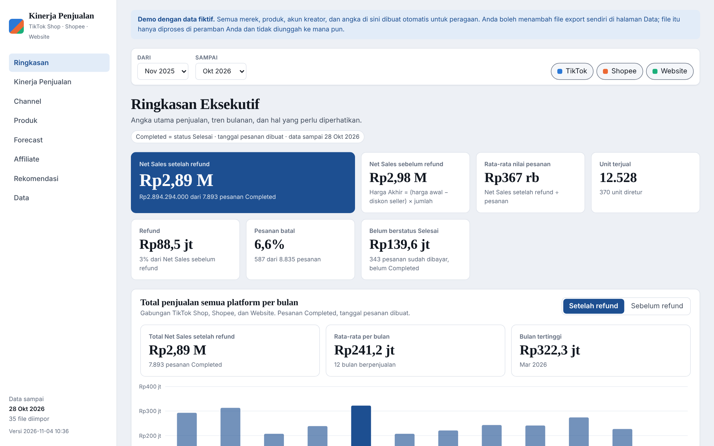
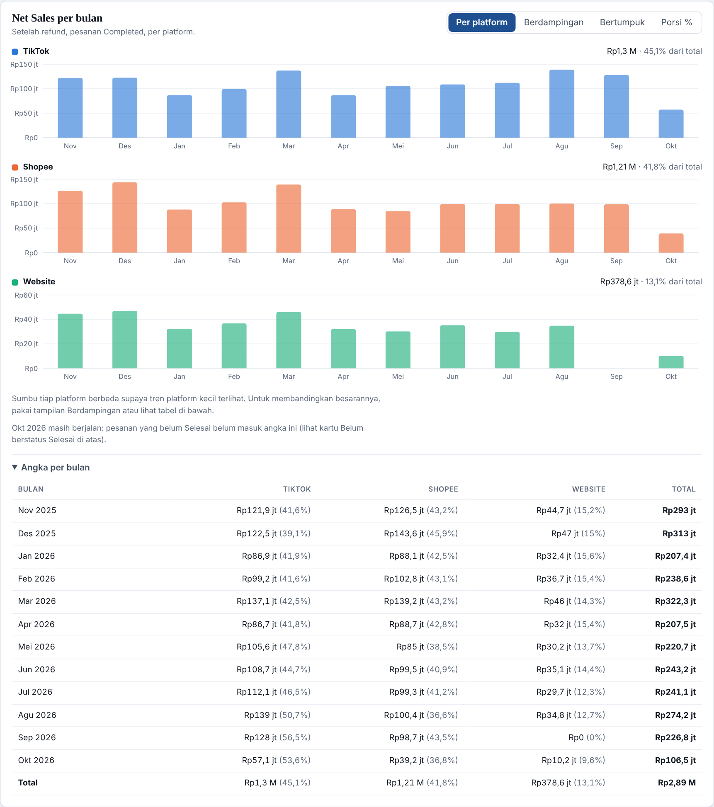
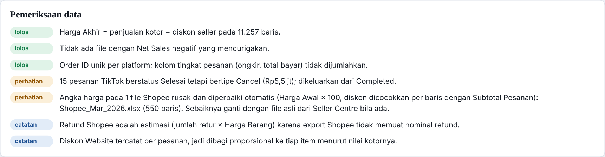
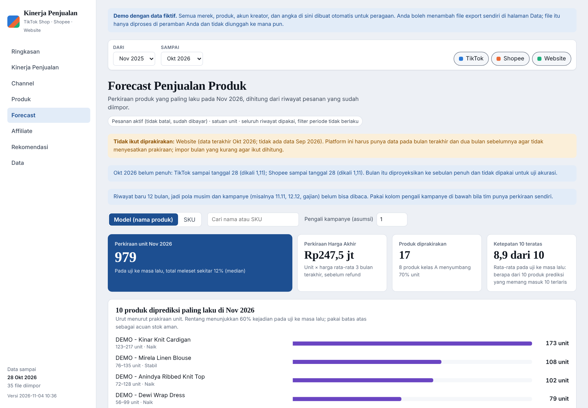
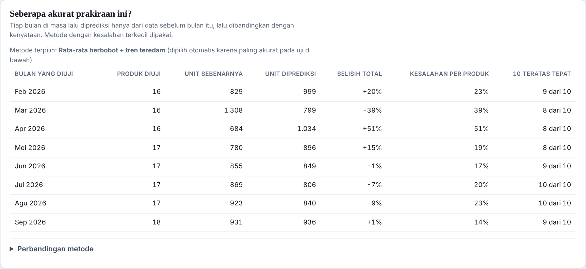

# Dashboard Kinerja Penjualan Multi-Platform

Dashboard untuk bisnis fashion e-commerce yang menyatukan penjualan **TikTok Shop, Shopee, dan Website** dari file export
bulanan menjadi satu tabel yang bersih, lengkap dengan KPI, analisis produk, dan **prakiraan produk terlaris bulan depan**.

> **Semua data di repositori ini fiktif.** Merek, produk, akun kreator, dan angkanya dibuat oleh
> [`scripts/generate-demo-data.py`](scripts/generate-demo-data.py). Format kolomnya meniru export marketplace, sehingga
> seluruh jalur impor bisa diperagakan tanpa membuka data perusahaan mana pun.

**Demo langsung:** [annisaashif.github.io/Performa-Sales-Dashboard](https://annisaashif.github.io/Performa-Sales-Dashboard/) (data fiktif; bisa dicoba tanpa memasang apa pun).



## Panduan

- **Cara memakai dashboard** (impor file, filter, membaca tiap halaman, memakai forecast): [`docs/PANDUAN-PENGGUNAAN.md`](docs/PANDUAN-PENGGUNAAN.md)
- **Cara memasang di komputer sendiri** (XAMPP atau Laragon, MySQL): [`docs/PANDUAN-SETUP.md`](docs/PANDUAN-SETUP.md)

## Masalah yang diselesaikan

Tiga kanal penjualan memberi tiga format export yang berbeda: nama kolom, status pesanan, cara menulis diskon, bahkan format
tanggal. Laporan manual dari tiga file itu rawan angka ganda, refund yang terhitung dua kali, dan definisi "penjualan" yang
berbeda antar orang. Dashboard ini membuat satu definisi, satu tabel, dan satu tempat untuk memeriksa asal tiap angka.

## Apa yang bisa dilakukan

| Halaman | Isi |
|---|---|
| Ringkasan | KPI utama, total penjualan semua platform per bulan, perbandingan Shopee/TikTok/Website, status pesanan, temuan penting |
| Kinerja Penjualan | Tren, pola hari dalam minggu dan jam pesanan, tabel periode |
| Channel | Komposisi dan perbandingan platform, sumber pesanan TikTok (LIVE, video, product card) |
| Produk | Gabungan lintas platform per model atau SKU, kelas ABC, kategori |
| **Forecast** | Prakiraan unit per produk untuk bulan depan, rentang, tren, tingkat keyakinan, dan uji akurasinya |
| Affiliate | Penjualan menurut kreator; akun toko sendiri dipisahkan dari affiliate |
| Rekomendasi | Temuan berbasis aturan (bukan AI generatif), tiap temuan menyebut ambang yang dipakai |
| Data | Impor file, riwayat file (data lineage), pemeriksaan kualitas data, definisi KPI |



## Aturan data (definisi KPI)

- **Completed** hanya pesanan berstatus Selesai. Tanggal memakai tanggal pesanan dibuat.
- **Net Sales (Harga Akhir)** = (harga awal − diskon penjual per unit) × jumlah. Diskon platform tidak dikurangkan.
- Net Sales ditampilkan **sebelum dan sesudah refund**; refund dikurangkan satu kali saja.
- Satu baris = satu SKU dalam satu pesanan. Nominal tingkat pesanan (ongkir, total bayar) tidak dijumlahkan, agar tidak terhitung ganda.
- Mengimpor ulang file yang sama **menimpa**, bukan menggandakan (kunci unik `platform|pesanan|SKU|variasi`).
- Tidak ada angka laba: data biaya produk tidak ada, jadi laba tidak dihitung.

## Kualitas data

Halaman **Data** memeriksa setiap impor dan menampilkan hasilnya, bukan menyembunyikannya:



- Pesanan TikTok yang berstatus Selesai tetapi bertipe Cancel dikeluarkan dari Completed dan dilaporkan.
- File dengan Net Sales negatif (diskon melebihi harga) ditolak atau ditandai, karena itu tanda angka rusak.
- **Perbaikan file Shopee yang angkanya rusak.** Pada kasus nyata, angka harga di sebuah file Shopee bergeser skalanya
  (mis. Rp299.000 tertulis 2.990) sehingga Net Sales negatif. Aplikasi mendeteksinya lewat ketidakcocokan
  *Harga Setelah Diskon × Jumlah* dengan *Subtotal Pesanan*, memperbaiki Harga Awal × 100, lalu mencari skala diskon per baris
  yang membuat hitungan cocok dengan Subtotal Pesanan. Baris yang tidak bisa dicocokkan secara unik dibuang, dan file ditolak
  bila kurang dari 98% baris bisa diperbaiki. Pada data demo, file Shopee Maret 2026 dirusak dengan **simulasi** pola ini:
  593 dari 593 baris pulih dan semua total identik dengan versi aslinya
  (diverifikasi dengan [`scripts/verify-repair.ts`](scripts/verify-repair.ts)).

## Forecast: produk apa yang akan laku bulan depan



**Cara kerja**

1. Dasar hitung adalah unit pada pesanan aktif (tidak batal, sudah dibayar), bukan hanya Selesai, karena pesanan beberapa minggu terakhir belum sempat Selesai.
2. Bulan terakhir yang belum penuh diproyeksikan ke sebulan penuh menurut tanggal terakhir datanya, per platform.
3. Empat metode sederhana dibandingkan (sama dengan bulan terakhir, rata-rata 3 bulan, rata-rata berbobot 50/30/20, dan berbobot ditambah tren teredam). Setiap bulan di masa lalu diprediksi hanya dari data sebelum bulan itu (*backtest*), lalu metode dengan kesalahan terkecil dipilih otomatis.
4. Rentang unit berasal dari sebaran selisih nyata pada backtest (persentil 20 sampai 80), bukan tebakan.
5. Produk diberi tren (naik/stabil/turun/baru), tingkat keyakinan, dan kelas ABC. Rekomendasi stok memakai aturan sederhana yang ambangnya tertulis.



**Batasan yang sengaja ditampilkan di halaman**

- Belum membaca musim dan kampanye (11.11, 12.12, Lebaran). Pada data demo, November dan Desember 2025 memang sedang puncak, tetapi prakiraan November 2026 tidak "tahu" itu. Karena itu ada kolom **pengali kampanye** sebagai asumsi manual yang diberi label jelas.
- Platform hanya ikut diprakirakan bila punya data pada bulan terakhir dan dua bulan sebelumnya. Pada demo, Website tidak ikut karena data September sengaja dibolongkan, dan halaman menyebut alasannya.
- Angka akurasi di demo (kesalahan total sekitar 12% median) berlaku **untuk data demo**, bukan jaminan untuk data lain.

## Teknologi

- **Frontend:** React 19 dan TypeScript, dibundel dengan esbuild; grafik SVG buatan sendiri dengan d3-scale; validasi sampel dengan Zod; pembaca `.xlsx` dan `.csv` sendiri (JSZip), semuanya berjalan di peramban.
- **Backend lokal:** PHP 8 dan MySQL (PDO) untuk menyimpan data agar bisa di-query lewat phpMyAdmin; impor bertahap dan idempoten.
- **Demo statis:** build yang sama dengan lapisan penyimpanan diganti memori, sehingga bisa dihosting di GitHub Pages tanpa server.

## Menjalankan

**Demo tanpa server.** Buka alamat demo di atas, atau jalankan sendiri: buka `docs/index.html` lewat server statis (`npx serve docs`). Untuk menayangkan salinan sendiri lewat GitHub Pages:
*Settings → Pages → Source: Deploy from a branch → Branch: `main`, folder `/docs`*.

**Versi lokal dengan MySQL.** Ikuti [`docs/PANDUAN-SETUP.md`](docs/PANDUAN-SETUP.md) (XAMPP atau Laragon). Setelah itu impor file
di folder [`demo-data/`](demo-data) lewat menu Data untuk mencoba seluruh alurnya.

**Membangun ulang** (perlu Node.js):

```
npm install
npm run build        # versi lokal  -> assets/
npm run build:demo   # versi demo   -> docs/
npm run demo:data    # buat ulang data demo (Python 3 + openpyxl) dan demo/demo-data.json
npx tsx scripts/test-forecast.ts   # uji logika forecast
```

## Struktur

```
src/lib/      normalisasi tiga format export, KPI, forecast, pembaca xlsx/csv
src/ui/       halaman dan grafik
api/          backend PHP (impor, ekspor JSON, daftar file)
database/     skema MySQL
demo-data/    35 file contoh fiktif dalam format export marketplace
docs/         demo statis (GitHub Pages), panduan penggunaan dan setup, screenshot
scripts/      build, pembuat data demo, uji forecast, verifikasi perbaikan file
```

## Keterbatasan dan rencana

- Belum ada otentikasi; backend PHP hanya dimaksudkan untuk komputer lokal.
- Refund Shopee adalah estimasi (jumlah retur × Harga Barang) karena export Shopee tidak memuat nominal refund.
- Belum ada data biaya, jadi belum ada analisis laba.
- Rencana: pola musiman untuk forecast setelah riwayat lebih dari satu tahun, dan pembaruan otomatis dari export terjadwal.
